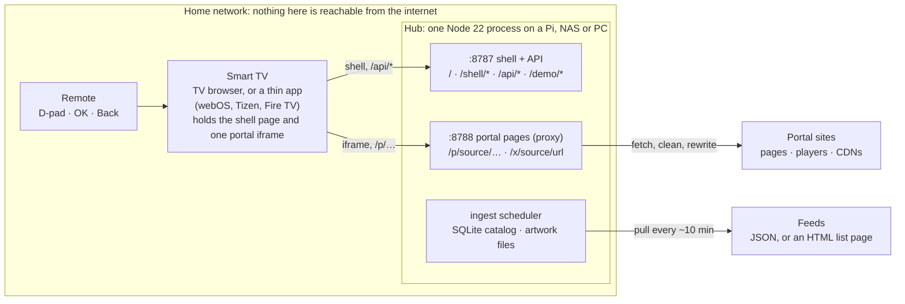
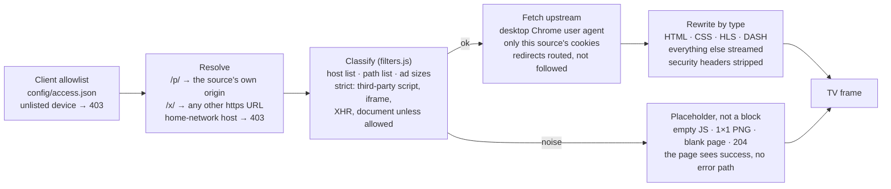
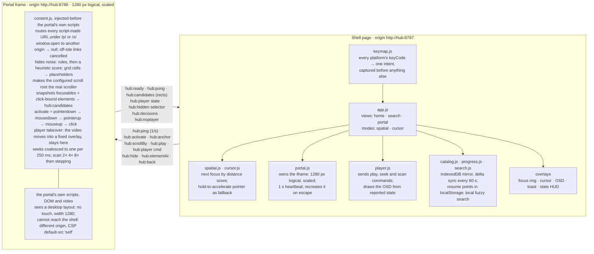
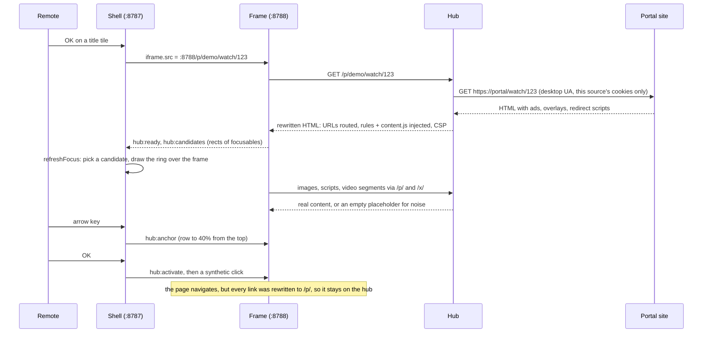
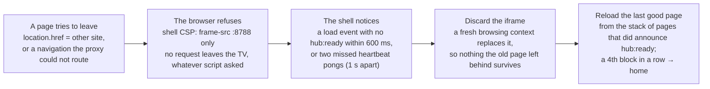
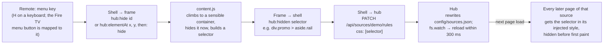
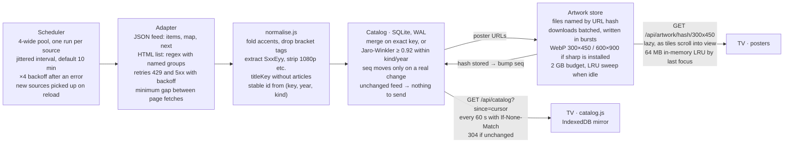

# How Media Hub works

How the TV system fits together today: a thin TV shell, a Node hub on the home network that
proxies and cleans portal pages, and a catalog pulled from the portals' feeds. The TV never talks
to a portal directly.

This is the companion to [SETUP.md](SETUP.md), which covers installing it. This page explains the
mechanism.

Contents: [The pieces](#the-pieces) · [Inside the hub](#inside-the-hub) · [On the TV](#on-the-tv) ·
[Opening a title](#opening-a-title-end-to-end) · [Staying inside the hub](#staying-inside-the-hub) ·
[Rules from the couch](#rules-from-the-couch) · [The catalog](#the-catalog) · [Running it](#running-it) ·
[Where things live](#where-things-live)

## The pieces

Three things exist: the remote and TV, one Node 22 process called the hub, and the portal sites
out on the internet. The hub listens on two ports on purpose. Port 8787 serves the TV app (the
shell) and the hub's API. Port 8788 serves portal pages through a rewriting proxy. Because they
are different origins, a portal's JavaScript can never read the shell, its saved positions, or
the API.

Every byte the TV shows comes from the hub. The hub is the only thing that fetches from the
internet, so ads, pop-ups and redirects are stopped in one place for every TV in the house.

## Inside the hub

The whole server is `server/index.js` plus a handful of modules. Both ports share one guard: the
client allowlist in `config/access.json`. If that list is non-empty, any device whose address is
not on it gets a 403 page. The machine running the hub is always allowed.

### Port 8787: shell and API

| Route | What it does |
|---|---|
| `/` | Serves `shell/index.html` with a Content-Security-Policy whose `frame-src` allows only the portal origin. The browser itself refuses to send the iframe anywhere else. |
| `/shell/*`, `/demo/*` | Static files for the shell, and the deliberately messy demo portal. |
| `/api/env` | Tells the shell the portal origin to use for the iframe, built from the hostname the TV used. |
| `/api/sources` | The configured sources: id, name, home page path, rules. |
| `/api/catalog?since=N` | Delta of catalog items after cursor N. Returns 304 when the TV's cursor already equals the head. |
| `/api/artwork/<hash>/<size>` | Poster files, content-addressed, cached for a week. |
| `PATCH /api/sources/<id>/rules` | Merges a rules patch into `config/sources.json` on disk. Used by the rule inspector. |
| `POST /api/ingest/run` | Runs ingestion now, for one source or all. |
| `/api/status` | Item count, ingest state per source, and what the proxy blocked and why. |
| `/api/control` | The control channel's self-description: base address, how to send the token, every command. |
| `/api/tv`, `/api/tv/<id>` | The TVs that have opened the hub, with what each shows. A TV says hello at `/api/tv/hello`, listens on `/api/tv/<id>/events`, reports `/api/tv/<id>/state` and answers `/api/tv/<id>/ack`; a controller posts `/api/tv/<id>/command`. Behind `controlToken` ([CONTROL.md](CONTROL.md)). |
| `/api/catalog/search?q=`, `/api/catalog/item/<id>` | Titles across every source for a controller, best match first; one title. |
| `/p/*`, `/x/*` | Refused with a 404. Portal content is only served on the portal port. |

### Port 8788: the rewriting proxy

This port serves only three things: first-party portal pages under `/p/<source>/<path>`,
third-party assets under `/x/<source>/<encoded url>`, and the injected script and stylesheet under
`/shell/inject/`. Every request walks the same pipeline in `server/proxy.js`.

HTML pages additionally get:

* every `src`, `href`, `srcset` and CSS `url()` routed to `/p/` or `/x/`;
* the viewport and `<base>` removed, and `width=1280` set;
* meta-refresh redirects routed through the hub, or dropped;
* the source's rules, `content.js`, `content.css` and the hide-CSS injected into `<head>`;
* a CSP of `frame-ancestors <shell origin>` and `default-src 'self'`.

Three details matter for what the TV ends up seeing:

* **Strict third-party blocking** is on by default in `config/filters.json`. Scripts, frames and
  data calls to any domain other than the portal's own are neutralised whether or not that domain
  is on an ad list. Images, video, fonts and stylesheets from CDNs still pass. A portal that
  genuinely needs its player CDN gets it listed in that source's `allowHosts`.
* **Cookies are scoped per source.** Set-Cookie headers are renamed with a per-source prefix on
  the way in, and only that source's cookies are sent back, only to that source. Third parties
  cannot set cookies on the TV at all.
* **Streams go through the hub too.** HLS playlists and DASH manifests are rewritten line by line
  so every segment, key and variant loads via `/p/` or `/x/`. Video therefore passes through the
  Pi in both directions, which is why the setup guide insists on Ethernet.

## On the TV

The TV shows one page, `shell/index.html`, loaded from port 8787. That page owns the remote, the
focus ring, the home grid and the search screen. When you open a portal, it shows a single iframe
loaded from port 8788. The iframe is laid out at 1280 logical pixels, the desktop width portals
are built for, and scaled as one block to the TV surface with a CSS transform. Because the two
are different origins, the shell cannot read the frame's DOM and the frame cannot read the shell.
They talk only through `postMessage`, and both sides check the sender's origin.

The shell keeps focus, state and the catalog. The injected content script does everything that
needs the portal's DOM, and reports back only rectangles, state and selectors. The shell never
reads the frame's DOM.

### How a key press travels

`shell/js/keymap.js` installs a capture-phase listener on the shell window and maps the platform's
key codes (webOS, Tizen, Android or a desktop keyboard) into one intent set: up, down, left,
right, select, back, play, ff, rw, menu, info, search and so on. Mapped keys never reach anything
else. `app.js` then dispatches on intent and current state. During playback, left and right nudge
the seek target and ff cycles the scan rate. In cursor mode the arrows drive the virtual pointer.
Otherwise arrows call spatial navigation, select activates whatever is focused, and back pops one
portal page or returns home.

### How focus works inside a portal page

The shell cannot see the frame's elements, so the content script sends it a list. On load, on
scroll, on resize and after every DOM mutation (batched to one per frame), the script walks the
page and reports every visible focusable element plus any element that registered a click,
mousedown or pointerdown listener. Each entry is an id, a rectangle and a tag name. The shell
scales those rectangles into its own coordinates, runs `spatial.js` over them, and draws its focus
ring on top of the iframe. Moving focus sends `hub:anchor` so the frame scrolls the current row to
40% from the top, which also reaches infinite-scroll sentinels early. Pressing OK sends
`hub:activate`, and the script synthesises the full pointer and mouse sequence before calling
`click()`, because many portals bind to mousedown only.

### Playback

The video element never leaves the portal document, so its decoder and any DRM session are
undisturbed. On play the content script reparents the `<video>` into a fixed, full-frame overlay
it owns, un-fixes sticky headers via the injected CSS, and starts reporting time, duration and
paused state about twice a second. The shell only draws the OSD from those reports and saves a
resume point every three seconds into localStorage. Titles finished within 15 seconds of the end
drop off the Continue watching row.

## Opening a title, end to end

The shell builds the hub path from the source's item URL, the frame loads it on the portal
origin, and from then on every request the page makes is a hub request.

Before any of this, the shell booted: it asked `/api/env` for the portal origin, fetched
`/api/sources`, opened its IndexedDB mirror, rendered the home rows from what it already had,
then pulled catalog deltas. From then on it re-syncs every minute and re-renders only when
something changed. Rows on the home screen are Continue watching, Sources (with the Search tile),
Movies, Series and Episodes.

## Staying inside the hub

Portals try to leave in several ways: a script sets `location`, a meta refresh fires, a link opens
a new window, a player manifest points at a CDN directly. Each is handled at the layer that can
stop it cheapest, and the outermost layer is the browser itself.

The browser-enforced policy is the one that cannot be argued with; the heartbeat is there because
TV browsers do not reliably fire events for a refused navigation.

The layers, outermost first:

* **Origin isolation.** Shell on 8787, portal pages on 8788. Portal scripts cannot read the
  shell, change rules or read saved positions, and the API is not served on the portal port at
  all.
* **Shell CSP.** `frame-src` names only the portal origin. Proxied pages carry `frame-ancestors`
  naming only the shell, so nothing but the shell can frame them.
* **Proxied-page CSP.** `default-src 'self'` on the portal origin, so a direct load from any other
  host is refused by the browser and only hub requests ever happen.
* **Proxy rewriting.** Static URLs are rewritten in HTML and CSS; meta refresh is routed or
  dropped; HLS and DASH are rewritten; upstream redirects are not followed but their Location
  header is mapped back to a hub path.
* **Content script.** `fetch`, XHR, `src` and `href` setters and `setAttribute` are wrapped so
  script-made URLs go through the hub. `window.open` to another origin returns null. Clicks on
  off-site links are cancelled, and `_blank` becomes `_self`.
* **Strict third-party blocking** with placeholders, as described under the proxy.
* **Private-network guard.** The proxy will not fetch loopback, link-local or RFC 1918 addresses
  on a page's behalf unless the source itself lives there, which is how the demo portal on the
  hub's own address still works.
* **Client allowlist.** Both ports refuse devices not listed in `config/access.json` when the
  list is set.

There is no login. On a shared network without the allowlist, anyone can browse through the hub
and change rules. The ports are meant to stay inside the house and never be forwarded.

## Rules from the couch

Noise removal is driven by data in `config/sources.json`: a `css` list hidden before first paint,
a `removeOnMount` list applied by a mutation observer for late overlays, a `preserve` list that
protects grids and cards, a `scrollRoot` and a `player` selector. A generic heuristic (fixed or
sticky, high z-index, large coverage, ad-sized media, no video, little text, not navigation)
catches what the lists miss. The rule inspector lets you add to the `css` list from the TV
without touching a file.

Nothing restarts: the hub watches `config/`, and the same watcher picks up hand edits to sources,
filters and the client allowlist.

## The catalog

The home grid is not scraped from portal pages. A scheduler inside the hub pulls each source's
feed on its own interval, normalises titles so the same film from two providers becomes one item,
stores the result in SQLite, and fetches posters into a content-addressed artwork store. The TV
mirrors the catalog into IndexedDB with cheap delta pulls, so search and the home rows need no
network at all.

A poster becoming available bumps the owning items' sequence, so the TV learns about it on its
next delta pull without re-downloading the whole catalog.

Adding a provider is configuration, not code: a new entry in `config/sources.json` with the
portal's origin, a `feed` block describing its JSON endpoint or HTML list page, and rules. Saving
the file schedules the new source within a second. The two demo sources point at the hub's own
demo portal and feed, which is why a fresh install shows 24 made-up titles.

## Running it

On a Raspberry Pi the installer script sets up Node 22, clones the repo, installs a systemd unit
that runs `node server/index.js` with `PORT=8787`, and starts it. The portal port is always the
shell port plus one unless `HUB_PORTAL_PORT` says otherwise. Data lives under `data/` (SQLite
file, artwork) unless `HUB_DATA` moves it. Locally, `npm start` does the same on the PC and
`npm test` runs the unit suites for the classifier, the rewriter, normalisation, the catalog
delta, search and the allowlist.

### What the TV runs

Every TV platform runs the same shell page from the hub. The app on the TV is only a way to get a
full-screen browser pointed at it, so the app never needs updating when the hub changes.

| Platform | How it reaches the hub | Remote handling |
|---|---|---|
| Any TV browser | Bookmark `http://<pi>:8787` | Arrows, OK and Back work as browser keys; other buttons depend on the TV. |
| LG webOS | `shell/appinfo.json` packaged with the webOS CLI | Colour and media keys declared as `requiredKeys`; webOS key codes in `keymap.js`. |
| Samsung Tizen | `shell/config.xml` packaged with Tizen Studio | Media and colour keys registered at boot through the TV input device API. |
| Fire TV, Android TV, Google TV | The `android/` WebView app, built with the Pi's address baked in | The activity intercepts every key, re-dispatches it into the page as a raw Android key code, maps the Fire TV menu button to the hub's menu key, and treats a long press of Back as "leave the app". If the hub is unreachable it shows a plain retry page. |

### Configuration, all hot-reloaded

* `config/sources.json`: the portals, their feeds, their rules and per-source `allowHosts`.
* `config/filters.json`: ad host and path patterns, ad-unit sizes, the global `strict` switch and
  global `allowHosts`.
* `config/access.json`: the client allowlist.

The hub watches the folder and reloads any changed JSON after a 300 ms debounce, keeping the
previous config if the new file fails to parse. The scheduler starts timers for added sources and
drops them for removed ones. Diagnosis lives at `/api/status`, which lists blocked requests by
reason, and on the TV in the stats HUD (the info key, or `I`), which shows platform, view, focus
latency and the frame's recent hide and block decisions.

## Where things live

| Path | Role |
|---|---|
| `server/index.js` | Both HTTP servers, routing, the client guard, config watcher, startup of catalog, artwork and scheduler. |
| `server/proxy.js` | Resolve, classify, fetch, rewrite (HTML, CSS, HLS, DASH), cookie scoping, private-host guard, injection. |
| `server/filters.js` | Request classifier and the placeholder bodies per destination type. |
| `server/sources.js`, `server/access.js` | Loading and reloading sources and the allowlist; the rules patch writer; the control token check. |
| `server/tv.js` | The TVs and the command channel: hello, event streams, state, commands and their acks, the command list a controller reads. |
| `server/ingest/` | Scheduler, JSON and HTML adapters, title normalisation, SQLite catalog, artwork store, one-shot `run.js`. |
| `shell/index.html`, `shell/js/*` | The TV app: key router, state and views, spatial navigation, cursor, portal frame owner, player remote, catalog mirror, progress, search. |
| `shell/inject/content.js`, `content.css` | Injected into every proxied page: URL routing, popup blocking, noise removal, scroll root, candidates, activation, player takeover. |
| `config/` | Sources, filters, client allowlist. |
| `demo/` | The intentionally noisy demo portal, feed and HTML list used by the two demo sources. |
| `android/` | Fire TV and Android TV WebView wrapper. |
| `deploy/`, `docs/SETUP.md` | Pi installer, systemd unit, and the home setup guide. |
| `test/` | Node test suites for access, adapters, catalog, filters, normalise, proxy and search. |
