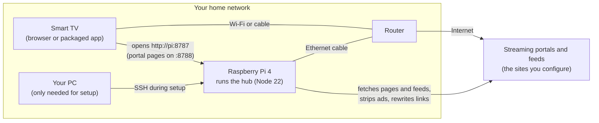

# Setting up Media Hub at home

This guide takes you from nothing to a TV that opens a clean, remote-friendly hub, with the hub
running on a Raspberry Pi (or any always-on machine) and locked to your own devices.

## How the pieces fit together



The TV never talks to a portal directly. It only ever talks to the hub. The hub fetches pages and
feeds from the sources, cleans them, and hands the result to the TV. That is why ads, pop-ups and
redirects are stopped in one place for every TV in the house.

```mermaid
sequenceDiagram
    participant R as Remote
    participant TV as TV (hub shell)
    participant H as Hub (Pi)
    participant S as Portal site

    R->>TV: Select a title
    TV->>H: GET /p/source/watch/123
    H->>S: GET https://portal/watch/123
    S-->>H: HTML with ads, overlays, redirect scripts
    H-->>TV: Rewritten HTML: ads replaced, links routed via hub, rules injected
    TV->>TV: Hide leftovers, draw focus ring, map D-pad
    TV->>H: Page requests (images, video, scripts)
    H-->>TV: Real content passes; ad and tracker requests get empty placeholders
    Note over TV: Frame cannot navigate anywhere except the hub (browser-enforced)
```

## What you need

| Item | Notes |
|---|---|
| Raspberry Pi 4 (2 GB+) or Pi 5 | A Pi 3 works for 1080p. Skip Pi Zero. Any always-on PC or NAS that runs Node 22 also works. |
| Ethernet cable from the Pi to the router | Video passes through the Pi in both directions. Do not use Wi-Fi for the Pi. |
| Raspberry Pi OS **64-bit** | Node 22 needs a 64-bit OS. Flash it with Raspberry Pi Imager and turn on SSH in the Imager settings. |
| A smart TV with a web browser | LG, Samsung, Sony, Hisense and most others have one. Packaging as an app is optional, see below. |
| Your PC, for setup | Windows PowerShell, macOS Terminal or Linux shell. |

## Step 1. Connect to the Pi

Plug the Pi into the router with the cable, power it on, and from your PC:

```bash
ssh pi@raspberrypi.local
```

Use the username you chose when flashing. If `.local` does not resolve, find the Pi's address in
your router's device list and use `ssh pi@192.168.1.xxx`.

If SSH is refused, enable it: with the SD card in your PC, create an empty file named `ssh` on
the boot partition, or re-flash with Raspberry Pi Imager and enable SSH in its settings.

## Step 2. Install the hub (one command)

On the Pi, this installs Node 22 and git, clones the hub, creates a service that starts at boot,
and starts it:

```bash
curl -fsSL https://raw.githubusercontent.com/jamesbobdev-gif/mediahub/main/deploy/install-pi.sh | bash
```

Prefer to see what it does first? The script is [`deploy/install-pi.sh`](../deploy/install-pi.sh)
and the manual steps are in the next section. When it finishes it prints the address to open.

### Manual steps (what the script does)

```bash
curl -fsSL https://deb.nodesource.com/setup_22.x | sudo -E bash - && sudo apt-get install -y nodejs git
```

```bash
git clone https://github.com/jamesbobdev-gif/mediahub.git ~/mediahub
```

```bash
sudo cp ~/mediahub/deploy/mediahub.service /etc/systemd/system/mediahub.service
```

Edit the service file if your username is not `pi` (two places), then:

```bash
sudo systemctl enable --now mediahub
```

```bash
systemctl status mediahub
```

It should say `active (running)`.

## Step 3. Open it on the TV

Find the Pi's address:

```bash
hostname -I
```

On the TV, open the web browser and go to `http://<pi-address>:8787`. Bookmark it. The remote's
arrows, OK and Back work immediately. If some button does nothing, see
[Remote keys](#remote-keys-that-do-nothing).

Reserve the Pi's address in the router (DHCP reservation / static lease) so it never changes.

## Step 4. Lock the hub to your devices

The hub has no login. By default any device on your Wi-Fi can use it. To allow only the TV:

```bash
nano ~/mediahub/config/access.json
```

```json
{
  "allowClients": ["192.168.1.123"]
}
```

Use the TV's address (Settings → Network on the TV). Save with Ctrl+O, exit with Ctrl+X. The hub
reloads the file on its own. Other devices now get a 403 page. The Pi itself is always allowed.
Reserve the TV's address in the router too, or update the file if it changes.

Never forward ports 8787 or 8788 on your router. The hub is for inside the house only.

The hub uses two ports: 8787 for the interface and API, 8788 for portal pages (kept on a separate
origin so portal scripts can never reach the interface). Both need to be reachable from the TV. On
a Pi there is no firewall by default; on a Windows PC allow both:

```bash
netsh advfirewall firewall add rule name="Media Hub" dir=in action=allow protocol=TCP localport=8787-8788
```

## Step 5. Add your sources from the TV

Everything you see at first is demo data served by the hub itself (two fake portals, 24 made-up
titles). Replace it from the couch: on the home screen, open the **Settings** card at the end of
the Sources row (or press the remote's menu button). The screen has the list of sources on the
left and, on the right, what the hub knows about the one under focus.

**Add a source.** Choose "Add a source", type a name and the site's address with the on-screen
keyboard (`pluto.tv` is enough; a page like `pluto.tv/us/on-demand` also works) and choose Save.
The hub then looks for a list of titles on that site: structured data on its pages, an RSS feed,
or its video sitemap. When it finds one, the site's titles and posters show up on the home screen
within a minute or two. When it finds nothing, the source still opens as a page from its card;
"Find its titles" tries again later. "Pull titles now" refreshes a source that has a feed.

**Remove a source.** Focus it, choose "Remove this source", and press OK again to confirm. Its
titles leave the home screen.

**Allow what a source needs.** If a source shows a blank page or no player, strict mode blocked
something it loads from another host. Open the source, let it try, then come back to Settings:
under "Blocked for this source" each host it asked for is listed with an Allow button. Allowing
one allows that whole site (for `abproxy.production-public.tubi.io`, all of `tubi.io`). Ads and
trackers are better left blocked; allow only the hosts the source needs to work.

All of this writes `~/mediahub/config/sources.json` on the Pi, the same file you can still edit
by hand for feeds the finder cannot work out (the format is in the
[README](../README.md#adding-a-source)). The file reloads on save either way.

To clear the demo titles from the catalog:

```bash
sudo systemctl stop mediahub && rm -rf ~/mediahub/data && sudo systemctl start mediahub
```

Tune the rules from the couch: open a source, press the menu/colour key mapped to `menu` (`H` on a
keyboard), and the element under focus is hidden and saved as a rule.

Only add sources you are entitled to access and scrape.

## Step 6. Stop the stick reporting home (optional)

A Fire TV Stick reports what you watch and do to Amazon, and fills its home screen with sponsored
rows. Two changes cut most of that off. Neither touches the hub: the stick reaches it by address
on your own network, and the Pi does all the fetching.

**On the stick, with the remote.** Settings, Preferences, Privacy Settings: turn off Device Usage
Data, Collect App and Over-the-Air Usage Data, and Interest-based Ads. Then Preferences, Featured
Content: turn off both autoplay switches. This reduces what is reported but does not stop it.

**On the Pi: Pi-hole.** Pi-hole is a DNS server. The stick asks it for the address of every name
it wants to reach. Names on the blocklist (ad servers, Amazon's reporting hosts) get no answer, so
the stick gives up as if the server did not exist. Nothing is installed on the stick. Install it
on the same Pi as the hub:

```bash
curl -sSL https://install.pi-hole.net | bash
```

Take the defaults: the wired interface, an upstream such as Cloudflare, the standard blocklist,
logging on. The installer prints a password for its page at the end. Change it with
`sudo pihole setpassword`. The page is at `http://<pi-address>/admin`.

On that page add the two smart-TV lists (kept by Perflyst on GitHub) under Lists, then run Tools,
Update Gravity:

```
https://raw.githubusercontent.com/Perflyst/PiHoleBlocklist/master/AmazonFireTV.txt
https://raw.githubusercontent.com/Perflyst/PiHoleBlocklist/master/SmartTV.txt
```

**Point the stick at it.** The DNS change is made on the stick alone, so nothing else in the house
changes. On the stick: Settings, Network, select your Wi-Fi, press the menu button and choose
Forget. Join it again, type the Wi-Fi password, and pick Advanced before connecting. Keep the
stick's current address, the router's address as the gateway, and the Pi's address as DNS 1.
Leave DNS 2 blank if it lets you; if it insists, give it the Pi's address again. Any other DNS
there is a way around the block.

**Check it.** The Pi-hole page's Query Log shows the stick's lookups and which were refused. If an
app on the stick stops working, find the refused name there and allow it; nothing is permanent.
When the Pi is off the stick has no internet until it is back, which is also when the hub is off.
A few apps carry their own fixed DNS and slip past this, which is why the switches above matter too.

## Updating

When the repository changes:

```bash
cd ~/mediahub && git pull && sudo systemctl restart mediahub
```

Your `config/` files are not touched by updates unless you edited the demo entries in place, in
which case git will tell you about a conflict. To keep your edited `sources.json` out of every
future update, tell git once to leave it alone:

```bash
cd ~/mediahub && git update-index --skip-worktree config/sources.json
```

## Useful commands

| What | Command |
|---|---|
| Hub status | `systemctl status mediahub` |
| Live log | `journalctl -u mediahub -f` |
| What got blocked and why | Settings on the TV, under the source; or open `http://<pi>:8787/api/status` |
| Re-run ingestion now | `curl -X POST http://<pi>:8787/api/ingest/run` |
| Stop / start | `sudo systemctl stop mediahub` / `sudo systemctl start mediahub` |
| How much the hub is answering from memory | `http://<pi>:8787/api/status`, under `cache`; or press the info key on the TV |

### Faster opens, at a price

The hub keeps a copy of the scripts, stylesheets, pictures and fonts a site sent, in memory, up
to 256 MB. The first open of a site still fetches everything from the internet; from the second
open on, most of those files come straight from the Pi, so the site appears in a fraction of the
time. The trade-off: when a site changes one of those files, the TV can keep showing the old one
for up to an hour (scripts and styles) or a day (pictures and fonts). Pages themselves, video and
anything personal are never kept, so what you watch and what is on the page is always current.
To change the size, add `Environment=HUB_CACHE_MB=512` (any number of megabytes) to
`/etc/systemd/system/mediahub.service` under `[Service]` and restart the hub; `HUB_CACHE_MB=0`
turns the copy off. Restarting the hub also empties it.

## Troubleshooting

**TV shows "This device is not allowed".** Its address is not in `config/access.json`, or the
router gave it a new one. Fix the file or reserve the TV's address.

**Page loads but a portal shows blank or missing player.** Strict mode blocked a script the
portal needs (its player CDN, for example). On the TV, open Settings, focus the source and allow
the host under "Blocked for this source". By hand: open `/api/status`, find the host under
`third-party-script:…`, and add it to that source's `allowHosts`. Hosts that carry the site's own
name (vimeocdn.com for vimeo.com, tubi.io for tubitv.com) are allowed without being listed.

**Buttons on a site do nothing, in cursor mode too.** Usually the same cause: the site's own
scripts were blocked, so the page is a picture of itself. Check "Blocked for this source" in
Settings for the site's script host and allow it.

**A source added from the TV has no titles on the home screen.** The finder found no list on
that site (no structured data, RSS feed or video sitemap). The source still opens from its card.
If you know a page or feed that lists its titles, add a `feed` block to its entry in
`config/sources.json` by hand, as in the README.

**Video stutters.** Check the Pi is on Ethernet, not Wi-Fi. On a Pi 3, 4K streams may exceed the
100 Mbit port.

**Remote keys that do nothing.** Press `I` (or the key mapped to `info`) to open the stats HUD,
then press the dead button. If nothing registers, its keyCode is missing from that platform's row
in `shell/js/keymap.js`. Add it and reload.

**Nothing loads at all.** `systemctl status mediahub` on the Pi. If it is not running,
`journalctl -u mediahub -n 50` shows why. The most common cause is a 32-bit OS (Node 22 needs 64-bit).

## Optional: a real app icon on the TV

The browser bookmark is enough. If you want an icon in the TV's app list:

- **LG webOS**: enable Developer Mode on the TV, install the webOS CLI on your PC, point
  `shell/index.html` at the hub's address, then `ares-package shell` and `ares-install`.
  `shell/appinfo.json` is provided.
- **Samsung Tizen**: Tizen Studio on the PC, developer mode on the TV, same idea.
  `shell/config.xml` is provided.
- **Fire TV, Android TV, Google TV**: the app in [`android/`](../android/README.md). Build it
  on the PC with the Pi's address, turn on ADB Debugging in the TV's Developer Options, and
  install it with `adb`. The README there has the exact steps. The Fire TV remote's menu
  button is the hub's menu key, and holding Back leaves the app.

On every platform the app is a thin shell that loads the hub; all logic stays on the Pi, so the
app never needs updating when the hub changes.
