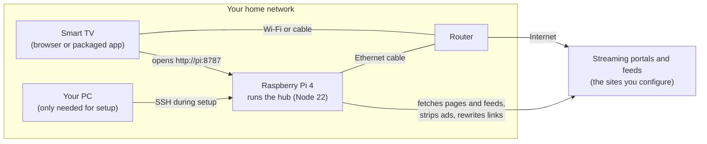

# Setting up Media Hub at home

This guide takes you from nothing to a TV that opens a clean, remote-friendly hub, with the hub
running on a Raspberry Pi (or any always-on machine) and locked to your own devices.

## How the pieces fit together



The TV never talks to a portal directly. It only ever talks to the hub. The hub fetches pages and
feeds from the sources, cleans them, and hands the result to the TV. That is why ads, pop-ups and
redirects are stopped in one place for every TV in the house.

```mermaid
sequenceDiagram
    participant R as Remote
    participant TV as TV (hub shell)
    participant H as Hub (Pi)
    participant S as Portal site

    R->>TV: Select a title
    TV->>H: GET /p/source/watch/123
    H->>S: GET https://portal/watch/123
    S-->>H: HTML with ads, overlays, redirect scripts
    H-->>TV: Rewritten HTML: ads replaced, links routed via hub, rules injected
    TV->>TV: Hide leftovers, draw focus ring, map D-pad
    TV->>H: Page requests (images, video, scripts)
    H-->>TV: Real content passes; ad and tracker requests get empty placeholders
    Note over TV: Frame cannot navigate anywhere except the hub (browser-enforced)
```

## What you need

| Item | Notes |
|---|---|
| Raspberry Pi 4 (2 GB+) or Pi 5 | A Pi 3 works for 1080p. Skip Pi Zero. Any always-on PC or NAS that runs Node 22 also works. |
| Ethernet cable from the Pi to the router | Video passes through the Pi in both directions. Do not use Wi-Fi for the Pi. |
| Raspberry Pi OS **64-bit** | Node 22 needs a 64-bit OS. Flash it with Raspberry Pi Imager and turn on SSH in the Imager settings. |
| A smart TV with a web browser | LG, Samsung, Sony, Hisense and most others have one. Packaging as an app is optional, see below. |
| Your PC, for setup | Windows PowerShell, macOS Terminal or Linux shell. |

## Step 1. Connect to the Pi

Plug the Pi into the router with the cable, power it on, and from your PC:

```bash
ssh pi@raspberrypi.local
```

Use the username you chose when flashing. If `.local` does not resolve, find the Pi's address in
your router's device list and use `ssh pi@192.168.1.xxx`.

If SSH is refused, enable it: with the SD card in your PC, create an empty file named `ssh` on
the boot partition, or re-flash with Raspberry Pi Imager and enable SSH in its settings.

## Step 2. Install the hub (one command)

On the Pi, this installs Node 22 and git, clones the hub, creates a service that starts at boot,
and starts it:

```bash
curl -fsSL https://raw.githubusercontent.com/jamesbobdev-gif/mediahub/main/deploy/install-pi.sh | bash
```

Prefer to see what it does first? The script is [`deploy/install-pi.sh`](../deploy/install-pi.sh)
and the manual steps are in the next section. When it finishes it prints the address to open.

### Manual steps (what the script does)

```bash
curl -fsSL https://deb.nodesource.com/setup_22.x | sudo -E bash - && sudo apt-get install -y nodejs git
```

```bash
git clone https://github.com/jamesbobdev-gif/mediahub.git ~/mediahub
```

```bash
sudo cp ~/mediahub/deploy/mediahub.service /etc/systemd/system/mediahub.service
```

Edit the service file if your username is not `pi` (two places), then:

```bash
sudo systemctl enable --now mediahub
```

```bash
systemctl status mediahub
```

It should say `active (running)`.

## Step 3. Open it on the TV

Find the Pi's address:

```bash
hostname -I
```

On the TV, open the web browser and go to `http://<pi-address>:8787`. Bookmark it. The remote's
arrows, OK and Back work immediately. If some button does nothing, see
[Remote keys](#remote-keys-that-do-nothing).

Reserve the Pi's address in the router (DHCP reservation / static lease) so it never changes.

## Step 4. Lock the hub to your devices

The hub has no login. By default any device on your Wi-Fi can use it. To allow only the TV:

```bash
nano ~/mediahub/config/access.json
```

```json
{
  "allowClients": ["192.168.1.123"]
}
```

Use the TV's address (Settings → Network on the TV). Save with Ctrl+O, exit with Ctrl+X. The hub
reloads the file on its own. Other devices now get a 403 page. The Pi itself is always allowed.
Reserve the TV's address in the router too, or update the file if it changes.

Never forward port 8787 on your router. The hub is for inside the house only.

## Step 5. Replace the demo sources with real ones

Everything you see at first is demo data served by the hub itself (two fake portals, 24 made-up
titles). Edit the sources file:

```bash
nano ~/mediahub/config/sources.json
```

Delete the demo entries and add yours. Each source needs the portal's address, a feed (JSON
endpoint or HTML list page) and rules. The format is documented in the
[README](../README.md#adding-a-source). The file reloads on save.

To clear the demo titles from the catalog:

```bash
sudo systemctl stop mediahub && rm -rf ~/mediahub/data && sudo systemctl start mediahub
```

Tune the rules from the couch: open a source, press the menu/colour key mapped to `menu` (`H` on a
keyboard), and the element under focus is hidden and saved as a rule.

Only add sources you are entitled to access and scrape.

## Updating

When the repository changes:

```bash
cd ~/mediahub && git pull && sudo systemctl restart mediahub
```

Your `config/` files are not touched by updates unless you edited the demo entries in place, in
which case git will tell you about a conflict. Copying your config to `config.local/` and
symlinking is a reasonable way to keep them separate if you update often.

## Useful commands

| What | Command |
|---|---|
| Hub status | `systemctl status mediahub` |
| Live log | `journalctl -u mediahub -f` |
| What got blocked and why | open `http://<pi>:8787/api/status` |
| Re-run ingestion now | `curl -X POST http://<pi>:8787/api/ingest/run` |
| Stop / start | `sudo systemctl stop mediahub` / `sudo systemctl start mediahub` |

## Troubleshooting

**TV shows "This device is not allowed".** Its address is not in `config/access.json`, or the
router gave it a new one. Fix the file or reserve the TV's address.

**Page loads but a portal shows blank or missing player.** Strict mode blocked a script the
portal needs (its player CDN, for example). Open `/api/status`, find the host under
`third-party-script:…`, and add it to that source's `allowHosts`.

**Video stutters.** Check the Pi is on Ethernet, not Wi-Fi. On a Pi 3, 4K streams may exceed the
100 Mbit port.

**Remote keys that do nothing.** Press `I` (or the key mapped to `info`) to open the stats HUD,
then press the dead button. If nothing registers, its keyCode is missing from that platform's row
in `shell/js/keymap.js`. Add it and reload.

**Nothing loads at all.** `systemctl status mediahub` on the Pi. If it is not running,
`journalctl -u mediahub -n 50` shows why. The most common cause is a 32-bit OS (Node 22 needs 64-bit).

## Optional: a real app icon on the TV

The browser bookmark is enough. If you want an icon in the TV's app list:

- **LG webOS**: enable Developer Mode on the TV, install the webOS CLI on your PC, point
  `shell/index.html` at the hub's address, then `ares-package shell` and `ares-install`.
  `shell/appinfo.json` is provided.
- **Samsung Tizen**: Tizen Studio on the PC, developer mode on the TV, same idea.
  `shell/config.xml` is provided.
- **Android TV / Google TV**: a minimal WebView wrapper app pointed at the hub address, sideloaded.

On every platform the app is a thin shell that loads the hub; all logic stays on the Pi, so the
app never needs updating when the hub changes.
